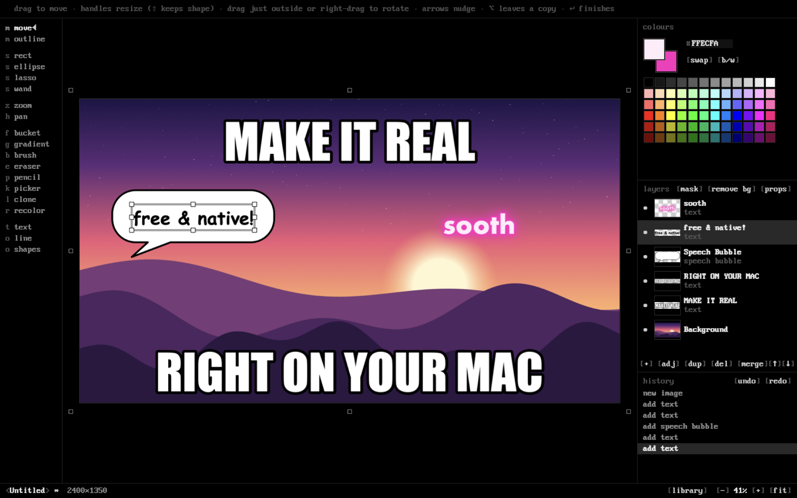
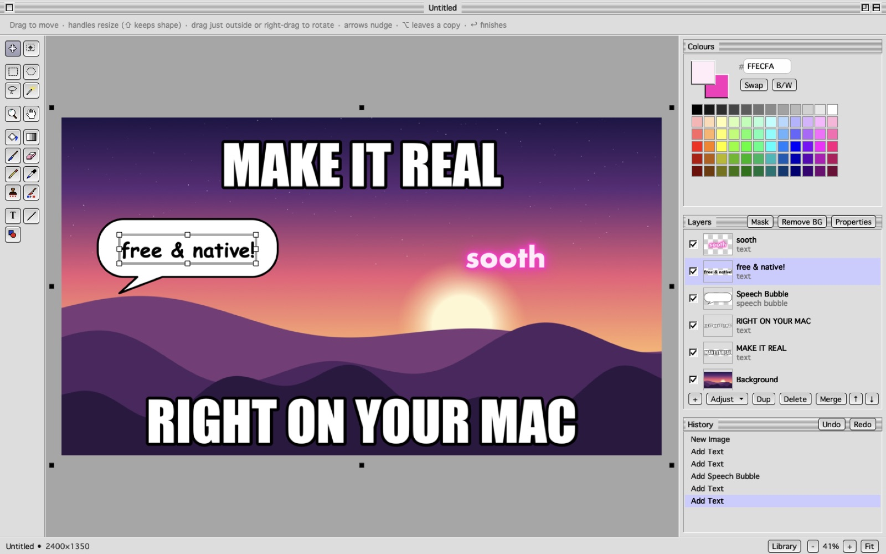
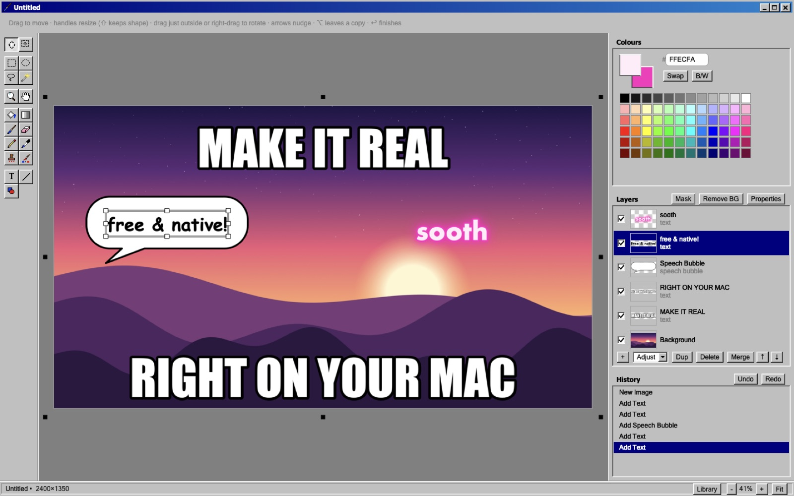
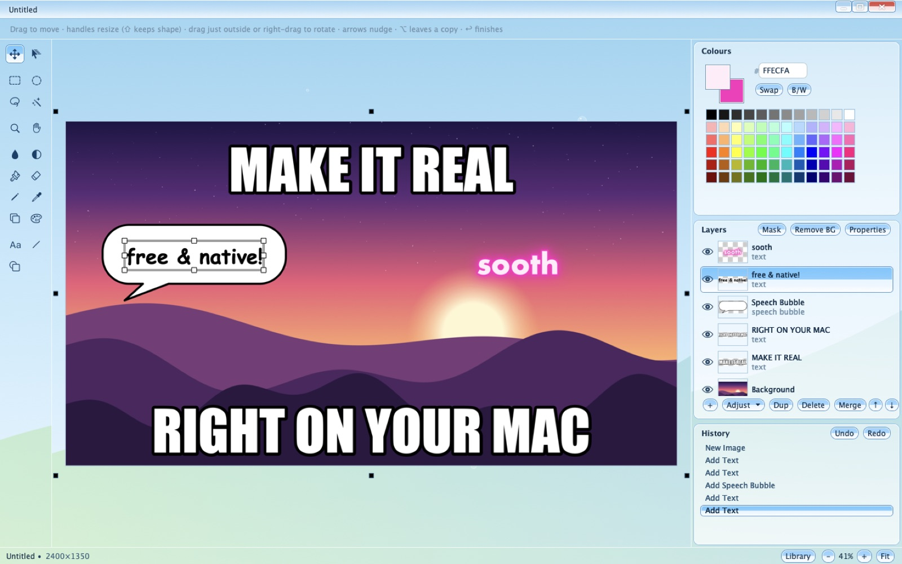
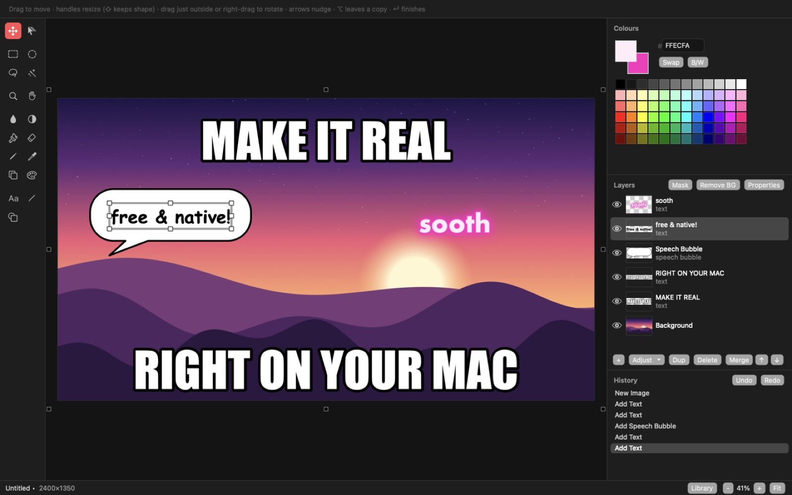

# Sooth

**A free, native image editor for the Mac, in the spirit of Paint.NET.** Made by Tianmu Labs.

Preview is too simple and Photoshop is too much. GIMP doesn't feel like a Mac app, and Pixelmator and Acorn cost money. Sooth takes the middle path Paint.NET made famous on Windows: open a picture, make the meme, fix the photo, drop in some text, and get on with your day. It's written in Swift with AppKit, starts instantly, and does everything on your Mac.

*Sooth* is Tianmu's word for making something real through intention, from the Old English *sōþ*, "truth".



## Five looks

The first time Sooth opens, it asks how you'd like it to look. Everything works the same in each, and View ▸ Look changes it any time.

| | |
|---|---|
| **Tianmu.** OLED black and an old IBM pixel font: the house look of Tianmu Labs. |  |
| **Platinum.** Pinstripes, lavender and Geneva, like a Mac in 1998. |  |
| **Bevel.** Grey bevels and a navy title bar, like a PC in 1995. |  |
| **Glass.** Glossy sky-blue glass and bubbles, from the Frutiger Aero years. |  |
| **Native.** Today's macOS: the system font, light or dark, your accent colour. |  |

Sooth draws every look itself, and the tool icons in Platinum and Bevel are pixel art made for it. The fonts are ones macOS already has (Geneva, Microsoft Sans Serif, Lucida Grande), plus the bundled IBM VGA font for the house look.

## What it does

**Layers that stay editable**
- **Text layers** are WYSIWYG: you type straight onto the canvas. Click text later to change its words, font or style.
- **Shape layers:** rectangle, rounded rectangle, ellipse, triangle, diamond, star, heart, arrow and speech bubble. You can move, resize, rotate and restyle them at any time.
- **Image layers.** Pasted, dropped and imported images keep their original pixels, so moving, resizing and rotating them never costs quality.
- **Flattening.** Layers become ordinary pixels only when you paint on them, run an effect, or merge them.
- **The layers panel** has 17 blend modes, opacity, drag to reorder, and a right-click menu.
- **Layer masks.** Paint black to hide and white to bring back, with any brush; start one from a selection.
- **Adjustment layers.** Curves, Levels, Hue / Saturation and eight more change everything below, live; double-click to re-tune, paint where they apply.
- **Vectorize.** Trace a drawing, logo or photo into smooth shapes that stay sharp at any size, and export them as SVG.
- **The Library.** Keep layers (text, shapes and pictures stay editable) and drop them into any image later.

**Text that looks good**
- Fonts, sizes and styles, plus alignment, spacing and rotation.
- Outlines and an outer outline, gradient fills, drop shadows, glow, and a caption box behind the text.
- Presets: Meme, Neon, Chrome, Comic, Subtitle and Sticker.

**Cut-outs, done on your Mac**
- **Remove Background** uses Apple's on-device subject model. You can fine-tune strength, edge softness and grow/shrink, and re-tune it later.
- **Double-click a person or thing** with the Move tool to lift it onto its own layer. The gap it leaves is filled in automatically.
- **The Eraser on a cut-out edits its mask.** Right-drag paints the subject back, so you can fix fringes without losing anything.
- **Magic Wand ▸ Subject** selects the thing you click.
- **Content-Aware Fill** (⇧⌫) removes whatever you've selected.

**Paint.NET's tools, the way you remember them**
- **Selections:** rectangle, ellipse, lasso and magic wand, with union, subtract, intersect and invert. Rectangle and ellipse also have fixed ratio and fixed size.
- **The two Move tools:** Move Selected Pixels and Move Selection. Each has its own cursor, and both have handles to move, resize and rotate.
- **Brush and Eraser** with hardness, opacity and tablet pressure.
- **More tools:** Pencil, Paint Bucket, Gradient, Clone Stamp, Recolor, Color Picker, and Line with arrowheads.
- **The same one-key shortcuts** as Paint.NET: press a key again to cycle the tools that share it.

**50 adjustments and effects**
- **Adjustments:** Curves (luminosity, RGB or per channel), Levels, Brightness/Contrast, Hue/Saturation, Exposure, Temperature/Tint, Shadows/Highlights, Vibrance, Auto-Level, Posterize, Sepia, Black and White, and Invert.
- **Photo:** Unsharp Mask, Red-Eye Removal and Soften Portrait.
- **Blurs, distortions, noise, render and stylize effects.**
- **Drop Shadow and Outline Object** for cut-outs.
- **For memes:** Deep Fry, Needs More JPEG and Chromatic Aberration.
- **Every effect previews live** and renders in the background, on all your cores.

**Files**
- **Opens** anything macOS can decode, plus Paint.NET `.pdn` files (versions 3–5, read-only).
- **Saves** layered `.sooth` files, which keep text, shapes and cut-outs editable. Also PNG, JPEG and HEIC (with a quality slider), TIFF and BMP.
- **Getting images in:** drag in files or images straight from a browser, and paste from anywhere.
- **Sharing:** File ▸ Share sends to AirDrop, Messages and Mail.
- **Safety:** autosave with crash recovery.

**Built to be quick**
- On a 48-megapixel photo, a brush event takes under a millisecond.
- Undo stores only the parts of the image that changed.


## Install

**Requirements:** macOS 14 Sonoma or later, on an Apple silicon or Intel Mac.

### From a release
1. Download `Sooth.zip` from the [Releases page](https://github.com/p-rudence/sooth/releases).
2. Unzip it and drag **Sooth** into Applications.
3. Sooth isn't notarized, so the first time you open it, Control-click the app and choose **Open**.

### From source
You need Xcode's command-line tools. There's no Xcode project; the build script calls `swiftc` directly.

```bash
git clone https://github.com/p-rudence/sooth.git
cd sooth
./build.sh              # builds and installs to /Applications
./build.sh --no-install # builds into build/ only
./build.sh --universal  # Apple silicon + Intel
```

## Using it

Press **⇧⌘/** in the app for the full shortcut list. The essentials:

| Keys | Does |
|---|---|
| `M` `S` `B` `E` `T` `O` … | Tools, the same keys as Paint.NET (press again to cycle) |
| Space | Pan with any tool |
| `[` `]` | Brush size |
| `X` | Swap primary and secondary colors |
| Double-click | Edit text, or lift a subject out of a photo onto its own layer |
| Right-drag | Rotate whatever you're moving |
| ⌥⌘B | Remove Background |
| ⇧⌫ | Content-Aware Fill the selection |
| ⇧⌘C | Copy merged |
| ⌘F | Repeat the last effect |

## Self-test

Sooth includes a headless test suite that drives the real tools, effects and file I/O. It also checks that live text renders the same as committed pixels, that moving and resizing object layers is lossless, and more:

```bash
build/Sooth.app/Contents/MacOS/Sooth --selftest /tmp/sooth-selftest
```

It prints one line per check and exits non-zero on any failure. `--bench` times the hot paths on a 48-megapixel canvas.

## Privacy

- Everything happens on your Mac, including subject detection and background removal (Apple's Vision framework, offline).
- There's no network access, no analytics, and no account.

## Credits and notes

- **Not affiliated with Paint.NET.** Sooth is an independent, clean-room project inspired by Paint.NET's workflow and is not affiliated with it. Paint.NET is a trademark of dotPDN LLC.
- **.pdn files** are read with a parser written from the public MS-NRBF specification.
- **Content-aware fill** follows PatchMatch (Barnes et al., 2009) and Wexler et al. (2007).
- **Fonts.** The house look uses PxPlus IBM VGA 8x16 from [The Ultimate Oldschool PC Font Pack](https://int10h.org/oldschool-pc-fonts/) by VileR, bundled unmodified under [CC BY-SA 4.0](https://creativecommons.org/licenses/by-sa/4.0/) (see `Resources/Fonts`). The other looks use fonts that ship with macOS.
- **Everything else is Sooth's own:** the pixel-art tool icons, the window chrome of each look, and the app icon.

## License

MIT, except the bundled VGA font, which keeps its CC BY-SA 4.0 licence. See [LICENSE](LICENSE).

Files saved under Sooth's earlier name, Easel (`.easel`), still open.
